# EI IDE

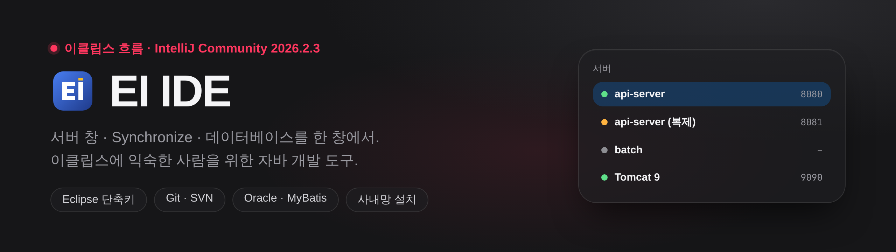

**[사용 설명서](https://raw.githack.com/guraking/ei-ide/main/docs/index.html)** · **[수정 내역](수정내역.md)** · **[내려받기](https://github.com/guraking/ei-ide/releases)**

<!-- 아래 그림은 docs/readme/index.html 을 docs/readme/capture.js 로 찍은 것이다. 글을 고치면 그 HTML 을 고치고 다시 찍는다. -->

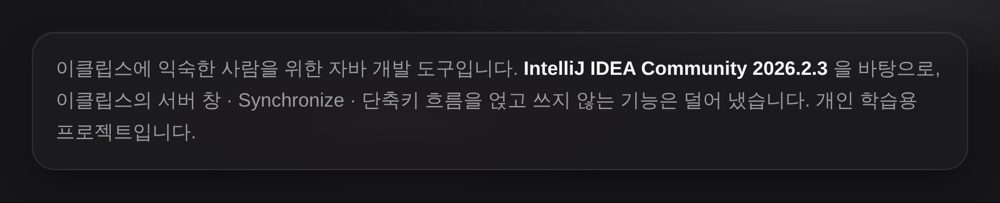

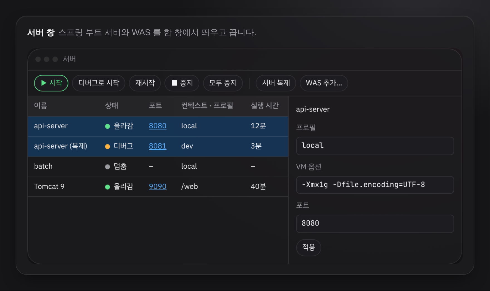

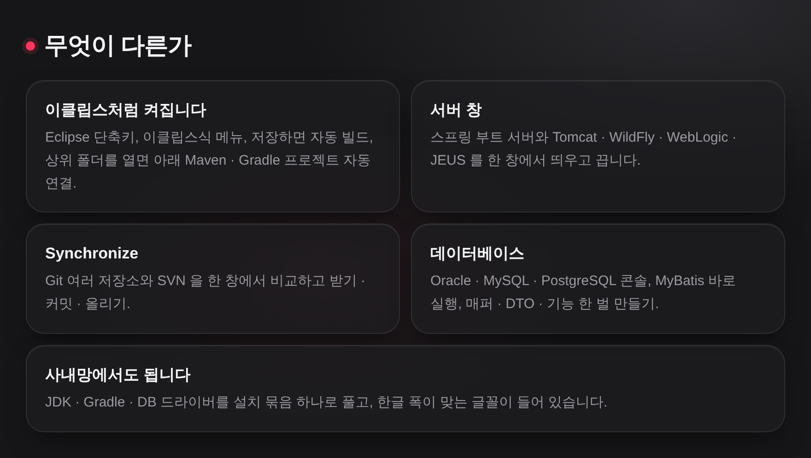

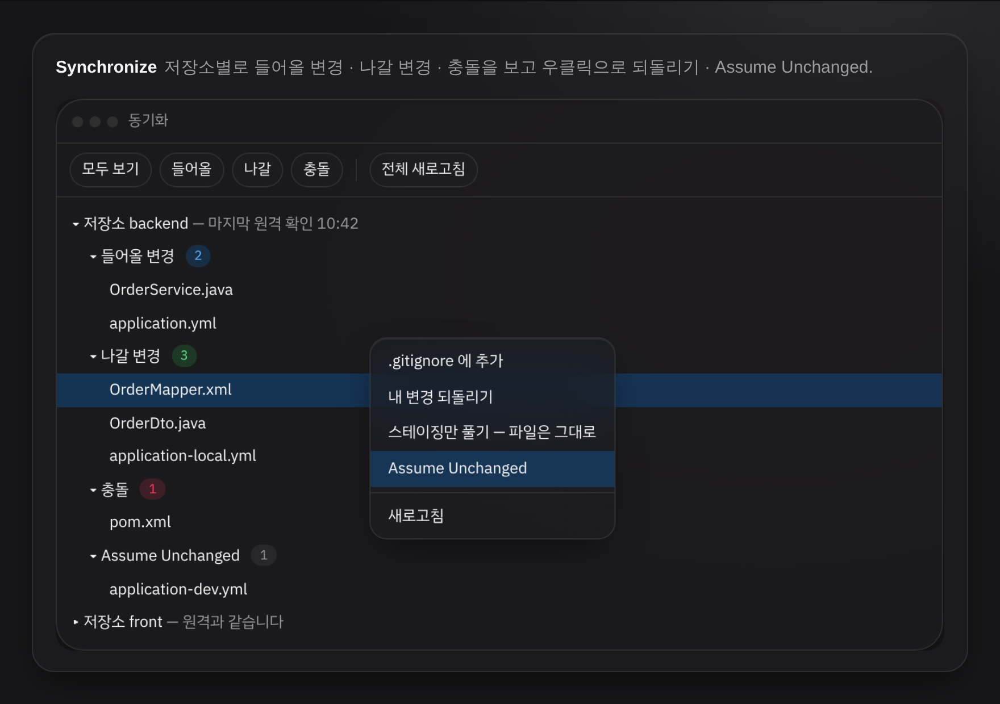

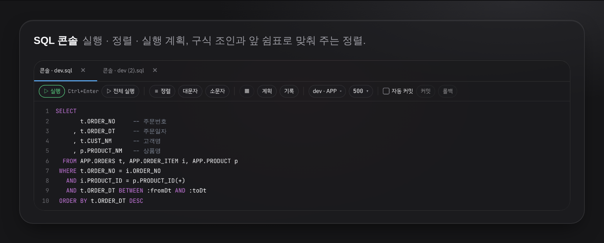

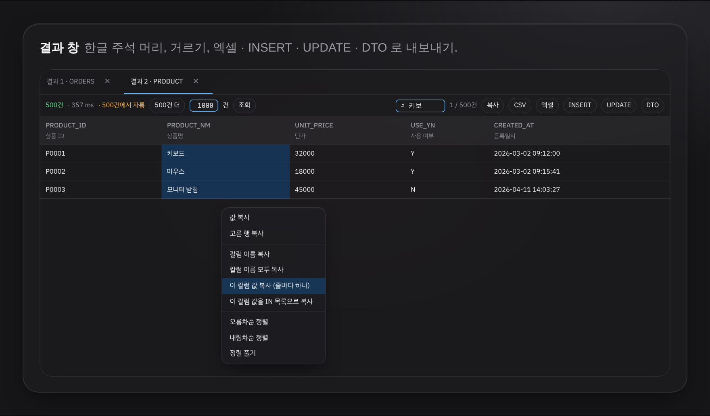

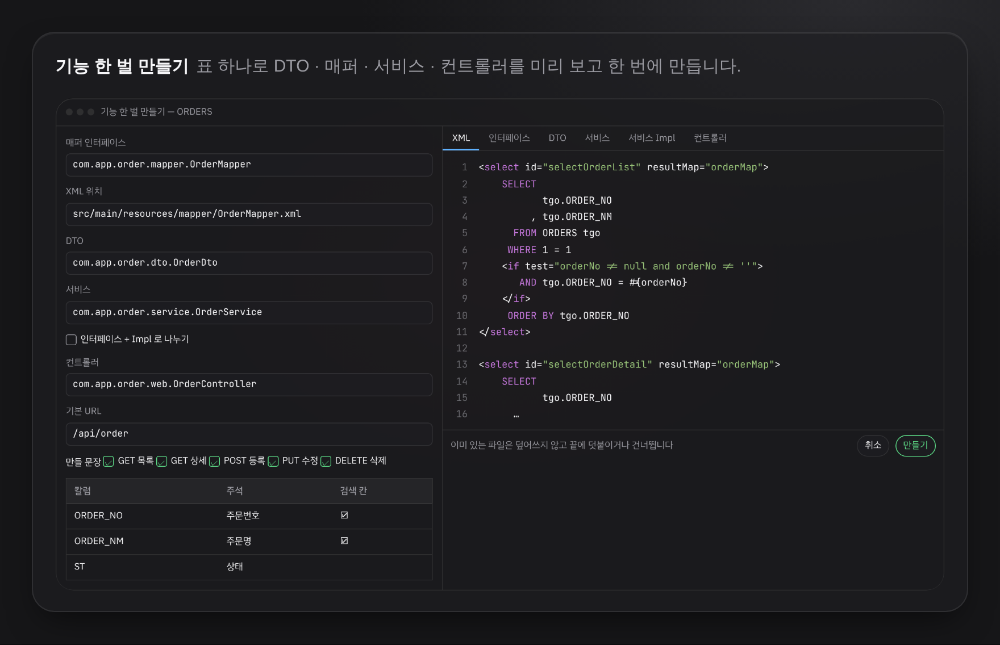

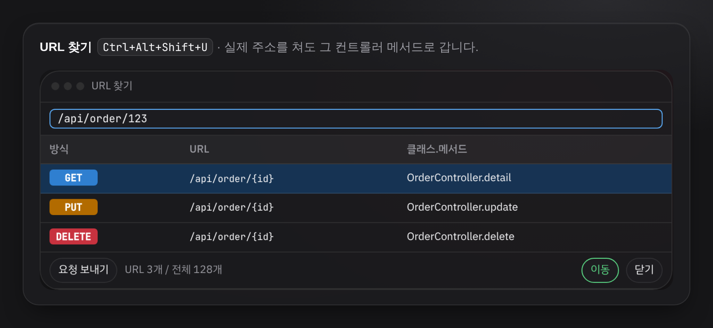

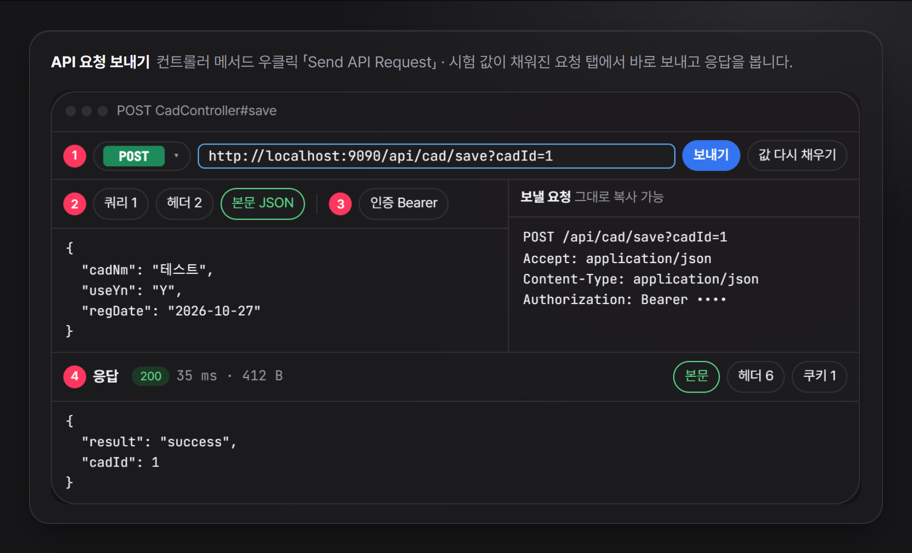

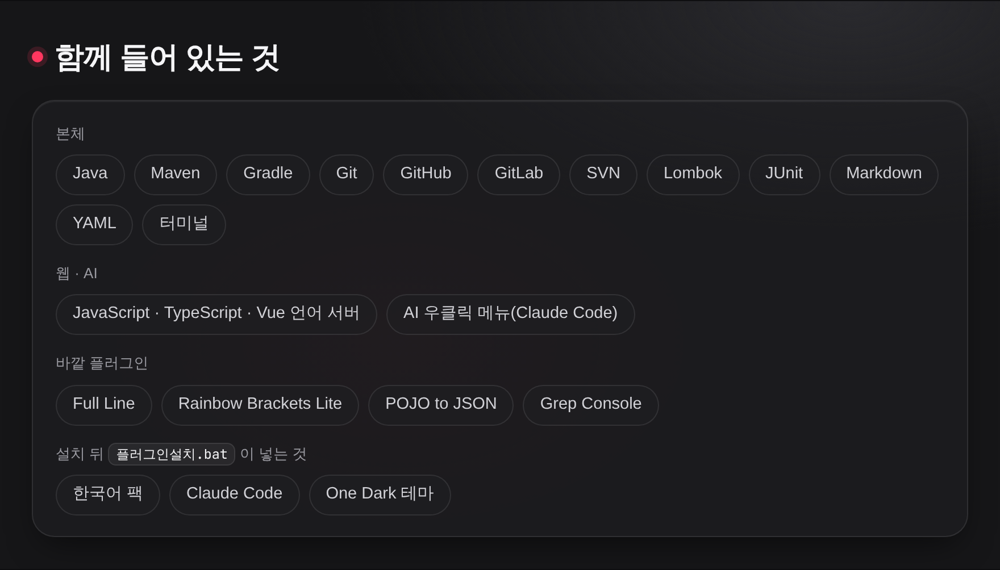

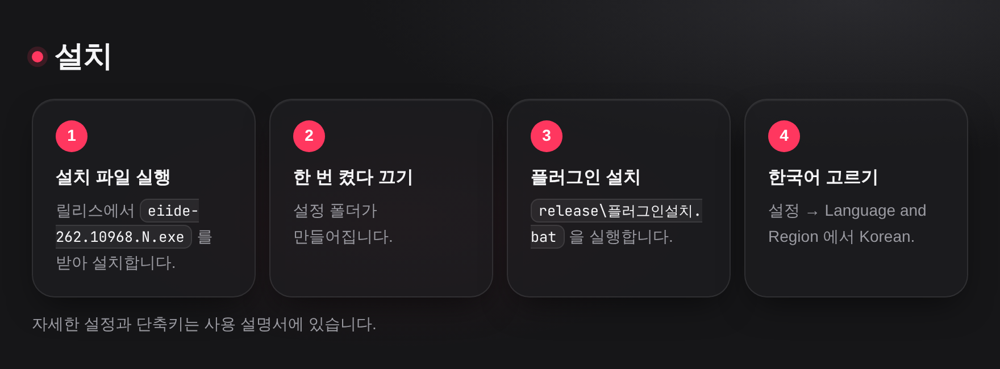

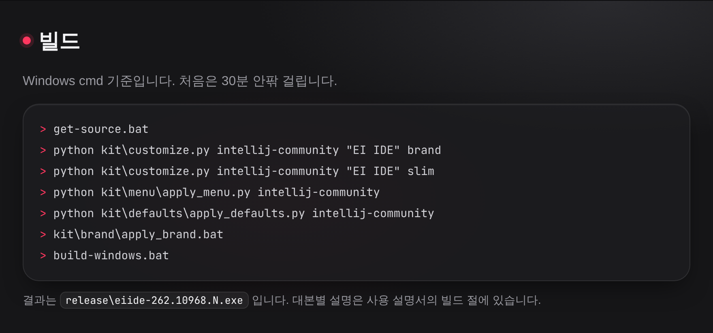

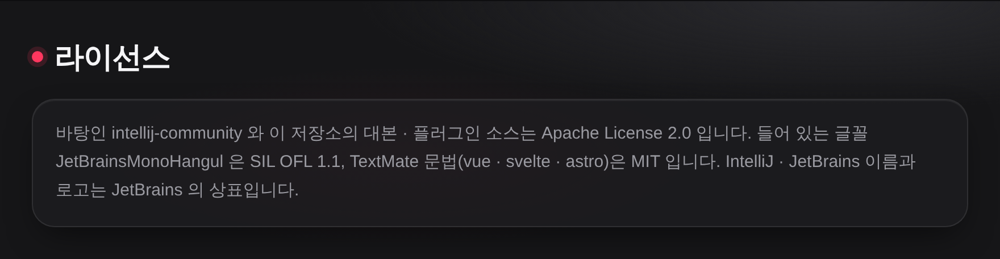

**[사용 설명서](https://raw.githack.com/guraking/ei-ide/main/docs/index.html)** · **[빌드 절](https://raw.githack.com/guraking/ei-ide/main/docs/index.html#build)** · **[내려받기](https://github.com/guraking/ei-ide/releases)**
