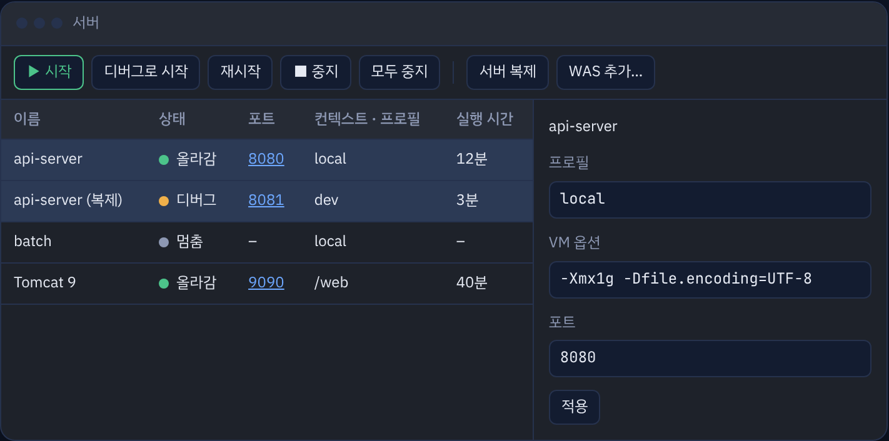
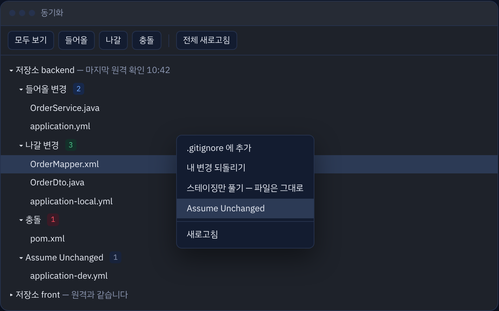
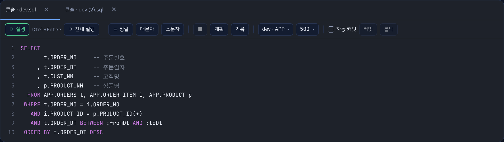
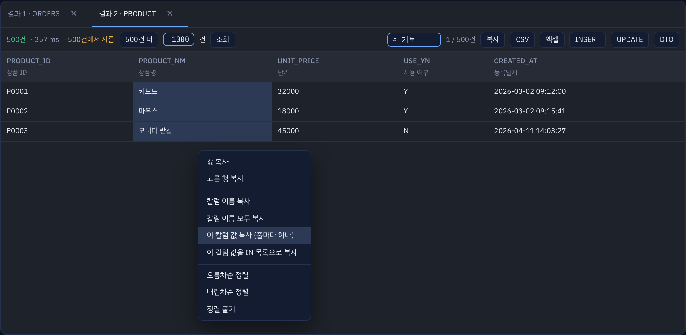
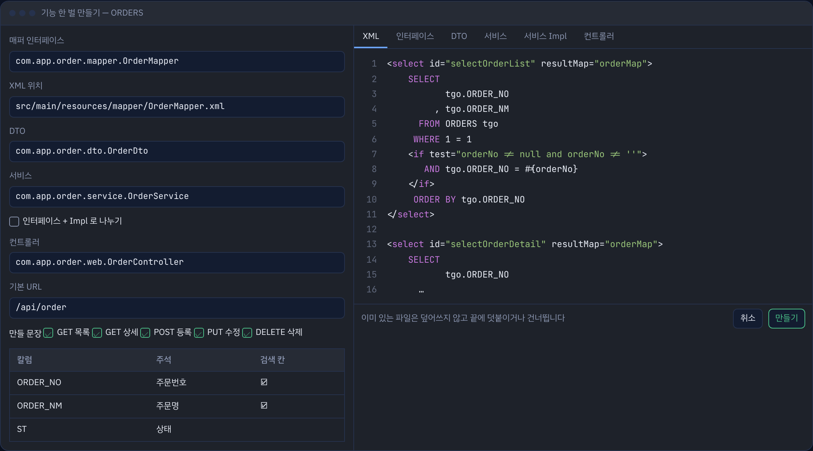
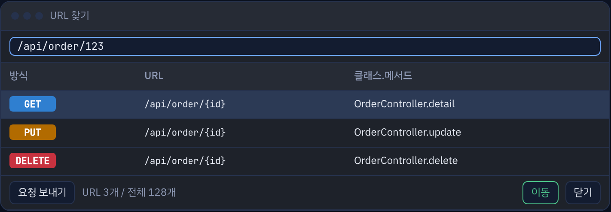
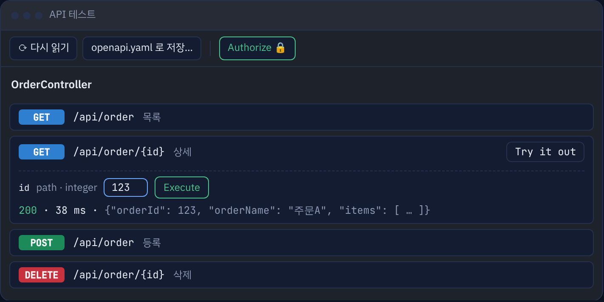

# EI IDE

이클립스에 익숙한 사람을 위한 자바 개발 도구입니다. IntelliJ IDEA Community 2026.2.3 을 바탕으로, 이클립스의 서버 창 · Synchronize · 단축키 흐름을 얹고 쓰지 않는 기능은 덜어 냈습니다. 개인 학습용 프로젝트입니다.

**[사용 설명서](https://raw.githack.com/guraking/ei-ide/main/docs/index.html)** · **[수정 내역](수정내역.md)** · **[내려받기](https://github.com/guraking/ei-ide/releases)**



## 무엇이 다른가

- **이클립스처럼 켜집니다.** Eclipse 단축키, 이클립스식 메뉴, 저장하면 자동 빌드, 상위 폴더를 열면 아래 Maven · Gradle 프로젝트 자동 연결.
- **서버 창.** 스프링 부트 서버와 Tomcat · WildFly · WebLogic · JEUS 를 한 창에서 띄우고 끕니다.
- **Synchronize.** Git 여러 저장소와 SVN 을 한 창에서 비교하고 받기 · 커밋 · 올리기.
- **데이터베이스.** Oracle · MySQL · PostgreSQL 콘솔, MyBatis 바로 실행, 매퍼 · DTO · 기능 한 벌 만들기.
- **사내망에서도 됩니다.** JDK · Gradle · DB 드라이버를 설치 묶음 하나로 풀고, 한글 폭이 맞는 글꼴이 들어 있습니다.

## 화면

> 아래 그림은 사용 설명서에 넣은 화면 모형입니다.

**Synchronize** · 저장소별로 들어올 변경 · 나갈 변경 · 충돌을 보고 우클릭으로 되돌리기 · Assume Unchanged.



**SQL 콘솔** · 실행 · 정렬 · 실행 계획, 구식 조인과 앞 쉼표로 맞춰 주는 정렬.



**결과 창** · 한글 주석 머리, 거르기, 엑셀 · INSERT · UPDATE · DTO 로 내보내기.



**기능 한 벌 만들기** · 표 하나로 DTO · 매퍼 · 서비스 · 컨트롤러를 미리 보고 한 번에 만듭니다.



**URL 찾기** (`Ctrl+Alt+Shift+U`) · 실제 주소를 쳐도 그 컨트롤러 메서드로 갑니다.



**API 테스트** · 컨트롤러로 만든 Swagger 화면에서 실행 중인 서버에 바로 요청합니다.



## 함께 들어 있는 것

- Java · Maven · Gradle · Git · GitHub · GitLab · SVN · Lombok · JUnit · Markdown · YAML · 터미널
- JavaScript · TypeScript · Vue 언어 서버, AI 우클릭 메뉴(Claude Code)
- Full Line · Rainbow Brackets Lite · SonarQube for IDE · POJO to JSON · Grep Console · JPA Buddy
- 설치 뒤 `플러그인설치.bat` 이 한국어 팩 · Claude Code · One Dark 테마를 넣습니다

## 설치

1. [릴리스](https://github.com/guraking/ei-ide/releases)에서 `eiide-262.10968.N.exe` 를 받아 설치합니다.
2. 한 번 켰다가 끕니다.
3. `release\플러그인설치.bat` 을 실행합니다.
4. 설정 → Language and Region 에서 Korean 을 고릅니다.

자세한 설정과 단축키는 [사용 설명서](https://raw.githack.com/guraking/ei-ide/main/docs/index.html)에 있습니다.

## 빌드

Windows cmd 기준입니다. 처음은 30분 안팎 걸립니다.

```
get-source.bat
python kit\customize.py intellij-community "EI IDE" brand
python kit\customize.py intellij-community "EI IDE" slim
python kit\menu\apply_menu.py intellij-community
python kit\defaults\apply_defaults.py intellij-community
kit\brand\apply_brand.bat
build-windows.bat
```

결과는 `release\eiide-262.10968.N.exe` 입니다. 대본별 설명은 [사용 설명서의 빌드 절](https://raw.githack.com/guraking/ei-ide/main/docs/index.html#build)에 있습니다.

## 라이선스

바탕인 intellij-community 와 이 저장소의 대본 · 플러그인 소스는 Apache License 2.0 입니다. 들어 있는 글꼴 JetBrainsMonoHangul 은 SIL OFL 1.1, TextMate 문법(vue · svelte · astro)은 MIT 입니다. IntelliJ · JetBrains 이름과 로고는 JetBrains 의 상표입니다.
